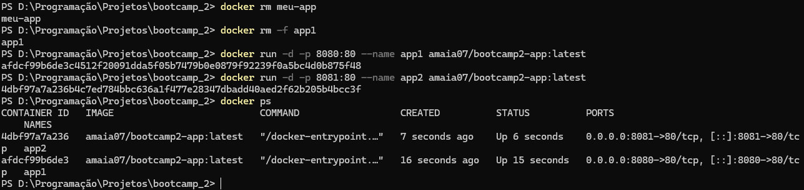

# Pokédex Web

## Autor
Artur Maia de Morais — Matrícula 22610962

## Descrição
Aplicação web que busca Pokémon pelo nome ou número (ou sorteia um aleatoriamente) e exibe imagem, altura, peso, tipos e geração. Na Etapa 02, ganhou persistência em banco de dados (um time de Pokémon favoritos) e foi empacotada em uma imagem Docker publicada no Docker Hub.

## Links
- **Aplicação no ar (GitHub Pages):** https://amaia07.github.io/bootcamp_2/
- **Repositório no GitHub:** https://github.com/AMaia07/bootcamp_2
- **Repositório no Docker Hub:** https://hub.docker.com/r/amaia07/bootcamp2-app

## Como executar com Docker (comando pronto)

```
docker run -d -p 8080:80 amaia07/bootcamp2-app:latest
```

Depois, acesse http://localhost:8080 no navegador. Tags disponíveis: `1.0`, `1.1` e `latest`.

## Como executar localmente (sem Docker)
1. Clone: `git clone https://github.com/AMaia07/bootcamp_2.git`
2. Abra o arquivo `index.html` no navegador (ou use a extensão Live Server do VS Code)

## API utilizada
- PokeAPI — https://pokeapi.co/docs/v2
- Endpoint consumido: 
- `https://pokeapi.co/api/v2/pokemon/{nome-ou-id}` (dados gerais do Pokémon)
- `https://pokeapi.co/api/v2/pokemon-species/{id}` (geração do Pokémon)

## Funcionalidades
- Busca por nome ou número (botão "Buscar" ou tecla Enter)
- Busca de um Pokémon aleatório (botão "Aleatório")
- Exibição de imagem, número, nome, altura (m), peso (kg), tipos e geração
- Imagem substituta quando o sprite não está disponível
- Validação de campo vazio e botões desabilitados durante o carregamento
- Mensagens amigáveis para busca sem resultado e falha de conexão
- **Meu time:** adicionar um Pokémon ao time, listar o time salvo e removê-lo
- Bloqueio de Pokémon duplicado no time (melhoria da versão 1.1 da imagem)

## Persistência de dados

- **Banco escolhido:** Supabase (PostgreSQL), acessado direto do frontend pela biblioteca `supabase-js`.
- **Tabela `time`:**

| Coluna | Tipo | Descrição |
|---|---|---|
| `id` | int8 | Identificador gerado automaticamente |
| `created_at` | timestamptz | Data e hora em que o Pokémon foi adicionado |
| `nome_pokemon` | text | Nome do Pokémon |
| `numero` | int8 | Número na Pokédex |
| `imagem` | text | URL do sprite |
| `tipos` | text | Tipos separados por vírgula (ex.: `fighting, steel`) |

- **O que é salvo:** os Pokémon que o usuário adiciona ao seu time. Os dados continuam lá depois de fechar o navegador ou recarregar a página.
- **Operações:** *Create* (botão "Adicionar ao time"), *Read* (seção "Meu time", carregada ao abrir a página) e *Delete* (botão "Remover"). O *Update* não foi implementado (era bônus).
- **Limitação conhecida:** as políticas de acesso (RLS) da tabela estão abertas para o papel `anon` (SELECT, INSERT e DELETE), como a etapa permite. Isso significa que não há login: todos os visitantes compartilham o mesmo time, e qualquer pessoa com a chave pública poderia alterar os dados. Em um produto real, o correto seria autenticar o usuário e criar políticas por usuário.

## Docker

O `Dockerfile` usa a imagem `nginx:alpine` e copia `index.html`, `style.css` e `script.js` para a pasta servida pelo Nginx, expondo a porta 80.

```
docker build -t bootcamp2-app .
docker run -d -p 8080:80 --name meu-app bootcamp2-app
```

## Sidequests

### SQ1 · .dockerignore
O arquivo `.dockerignore` lista o que não deve ser enviado ao Docker durante o build: `.git`, `README.md`, `README.pdf`, `.vscode`, `.DS_Store`, o próprio `Dockerfile` e o `.dockerignore`. Antes do build, o Docker envia a pasta do projeto inteira (o "contexto de build") ao motor do Docker. Ignorar arquivos desnecessários deixa esse contexto menor, o que torna o build mais rápido, e impede que arquivos sem função (como o histórico do Git, que pode ser grande) entrem na imagem caso um `COPY . .` seja usado no futuro, mantendo a imagem enxuta. No meu caso, o `COPY` do Dockerfile já seleciona só os três arquivos da aplicação, então o ganho de tamanho é pequeno, mas o contexto de build e a segurança contra cópias acidentais melhoram.

### SQ2 · Versionamento de imagem
Foram publicadas três tags no Docker Hub: `1.0` (primeira versão funcional), `1.1` (adiciona a verificação para não duplicar Pokémon no time) e `latest`.

### SQ3 · Descrição no Docker Hub
O repositório no Docker Hub tem a descrição curta e o overview preenchidos, com o que é a aplicação, o comando `docker run` pronto para copiar e o link do repositório no GitHub.

### SQ4 · Explorando a orquestração
Dois containers da mesma imagem rodando ao mesmo tempo, `app1` na porta 8080 e `app2` na porta 8081:

```
docker run -d -p 8080:80 --name app1 amaia07/bootcamp2-app:latest
docker run -d -p 8081:80 --name app2 amaia07/bootcamp2-app:latest
docker ps
```



**Se eu tivesse 100 containers, como gerenciaria?** Subir e acompanhar 100 containers com `docker run` à mão seria inviável: eu teria que escolher portas, reiniciar quem caísse e atualizar um por um. É para isso que existe o Kubernetes, um orquestrador de containers. Ele organiza as máquinas em um **cluster**, um conjunto de servidores (nós) tratados como uma única plataforma. Dentro dele, a menor unidade que ele gerencia é o **pod**, que envolve um ou mais containers que rodam juntos. Eu descrevo o estado desejado, por exemplo "quero 100 **réplicas** (cópias idênticas do pod) da minha aplicação", e o Kubernetes se encarrega de mantê-lo: distribui as réplicas pelos nós, recria automaticamente as que falharem, balanceia o tráfego entre elas e permite aumentar ou reduzir a quantidade e atualizar a versão aos poucos, sem derrubar o serviço.